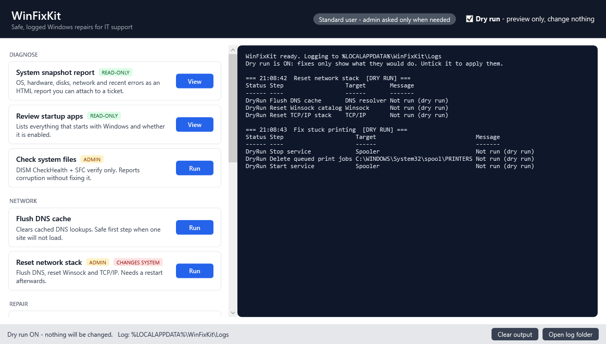

# WinFixKit

**The helpdesk's top 10 Windows fixes in one click. Every fix has a dry run, gets logged, and asks before changing anything.**

[](https://github.com/heditrigui/winfixkit/actions/workflows/ci.yml)


[](LICENSE)



WinFixKit is a small PowerShell module with a WPF front end. It packs the repairs IT support runs every day, from "the internet is broken" and "Windows Update is stuck" to "the printer won't print" and "the disk is full". Each fix is a small, documented function you can run from the GUI, a console or an RMM script.

## Install

```powershell
git clone https://github.com/heditrigui/winfixkit; .\winfixkit\WinFixKit.cmd
```

No git? Download the ZIP, extract it, run `Get-ChildItem -Recurse | Unblock-File` in the folder, then double-click **WinFixKit.cmd**.
Nothing else gets installed, and the toolkit never downloads anything at runtime.

## Features

| Fix | Function | Needs admin | What it does |
|---|---|:-:|---|
| System snapshot | `Export-SystemSnapshot` | - | OS, uptime, pending reboot, hardware, disks and disk health, network, recent errors, saved as an HTML/JSON/text report with flagged findings |
| Startup review | `Get-StartupItem` | - | Every Run key and Startup folder entry, with the Task Manager enabled/disabled state |
| Flush DNS | `Reset-NetworkStack -DnsOnly` | - | Clears the DNS resolver cache |
| Network reset | `Reset-NetworkStack` | Yes | DNS flush, `netsh winsock reset` and `netsh int ip reset`, plus an optional DHCP release/renew |
| Windows Update repair | `Repair-WindowsUpdate` | Yes | Stops the update services, renames `SoftwareDistribution` and `catroot2` (rename, not delete), then restarts the services |
| System file repair | `Repair-SystemImage` | Yes | `DISM /RestoreHealth` then `sfc /scannow`. `-ScanOnly` only checks; `-Source` repairs offline from a WIM |
| Print spooler | `Reset-PrintSpooler` | Yes | Stops the spooler, clears stuck jobs, starts it again |
| Temp & disk cleanup | `Invoke-TempCleanup` | Only with `-IncludeSystem` | Deletes old temp files (skips recent and in-use ones). Optional Windows Temp and WinSxS component cleanup |
| Store apps | `Repair-StoreApp` | - | Re-registers Store apps from their local manifests |
| Debloat (optional) | `Invoke-Debloat` | Only with `-IncludeProvisioned` | Removes apps from a short, conservative list (News, Tips, Solitaire, Clipchamp and others). All of them can be reinstalled from the Store |

## Safety

- **Dry run first.** The GUI starts with *Dry run* switched on. Every fix supports `-WhatIf` and returns the exact steps it would take, without needing admin rights.
- **Asks before acting.** Destructive fixes use `ConfirmImpact = 'High'`, so PowerShell prompts before each step. The GUI shows its own confirmation dialog.
- **Admin only when needed.** The GUI runs as a standard user. A fix that needs elevation opens its own UAC prompt and runs in a separate administrator window. No other fix gets elevated.
- **Everything is logged.** Every step, dry run, skip and failure goes to `%LOCALAPPDATA%\WinFixKit\Logs\WinFixKit-yyyyMMdd.log`. Set `WINFIXKIT_LOGDIR` to send the logs somewhere else.
- **Reversible where possible.** Windows Update caches are renamed to `*.bak-<timestamp>`, not deleted. Debloat removes only apps you can get back from the Store, and never touches Photos, Calculator, Media Player, Terminal or the Store itself.
- **Offline.** Nothing is downloaded at runtime, and a Pester test enforces this. DISM `/RestoreHealth` may use Windows Update as its repair source, which is a built-in Windows mechanism. Use `-Source` to stay fully offline.

## Use from PowerShell

```powershell
Import-Module .\WinFixKit\WinFixKit.psd1

Reset-NetworkStack -WhatIf                # preview the steps
Repair-WindowsUpdate                      # prompts before each step (run elevated)
Invoke-TempCleanup -OlderThanDays 7 -Confirm:$false
Export-SystemSnapshot | Invoke-Item       # open the HTML report
Get-StartupItem | Where-Object Enabled
Get-FixKitCatalog                         # every fix, with admin/destructive flags
```

Every fix returns `WinFixKit.StepResult` objects (`Step`, `Target`, `Status` = Done / DryRun / Skipped / Failed, `Message`, `Output`), so they are easy to use in scripts and RMM tools. Run `Get-Help <function> -Full` for the details.

## Project layout

```
WinFixKit/            the module (Public/ = exported fixes, Private/ = logging, elevation, GUI)
Start-FixKit.ps1      launches the GUI
WinFixKit.cmd         double-click launcher
tests/                Pester 5 tests (read-only paths and dry runs only)
.github/workflows/    PSScriptAnalyzer + Pester on Windows PowerShell 5.1 and PowerShell 7
```

## Development

```powershell
Invoke-ScriptAnalyzer -Path . -Recurse -Settings .\PSScriptAnalyzerSettings.psd1
Invoke-Pester ./tests
```

The tests never change the machine. They run the read-only functions, `-WhatIf` dry runs, and real deletes inside Pester's `TestDrive` only. To add a fix, write a function in `WinFixKit/Public` that sends each step through `Invoke-FixStep`, then add it to `Get-FixKitCatalog`. The GUI picks it up automatically.

Want a single `.exe`? [ps2exe](https://github.com/MScholtes/PS2EXE) is the usual tool for that, but it isn't set up in this repo. `WinFixKit.cmd` already gives you a double-click launcher.

## License

[MIT](LICENSE)
